# Crab puck

A physical status indicator for Claude Code, running on a LilyGO TTGO T-Display.
An animated pixel-art crab reacts to what Claude is doing.

<p align="center">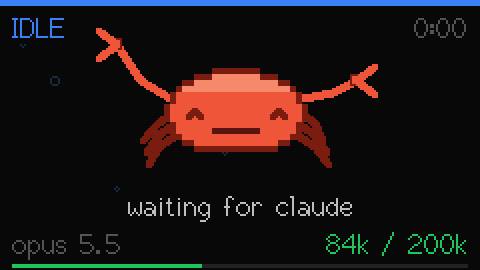</p>

## Quick start

You need a **LilyGO TTGO T-Display** (the ESP32 one with the 1.14" screen,
about £10), a USB-C data cable, Python 3 and Claude Code.

1. **Flash the board from your browser.** Open the
   [web flasher](https://lorenzwolf.github.io/crab-puck/) in Chrome or Edge, plug
   the board in and click *Connect & install*. No toolchain is needed.
2. **Install pyserial**, which the hooks use to talk to the board:
   `pip install pyserial`
3. **Install the plugin** from inside Claude Code:
   ```
   /plugin marketplace add lorenzwolf/crab-puck
   /plugin install crab-puck@crab-puck
   ```
   Restart Claude Code and the crab starts reacting.
4. **Check it** by sending a state by hand:
   `python hooks/crab.py working "hello"` should print `ok working`.

The plugin also adds a `crab-puck` skill, so you can ask Claude why the crab
isn't moving and it knows what to check.

### Privacy

The hooks read the tail of your local Claude Code transcript to show the
model name and context size. Nothing leaves your machine except the line
sent to the board over USB, which is the state, a short detail, the model
name and two numbers.

## Gallery

Captured straight from the display's frame buffer, so these are exact frames at the board's real 25 fps.

### Status

<table>
<tr><td align="center">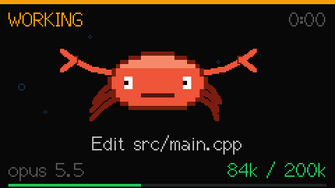<br><sub>working: scuttling</sub></td><td align="center">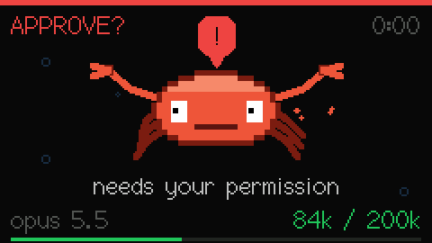<br><sub>approval: needs you</sub></td></tr>
<tr><td align="center">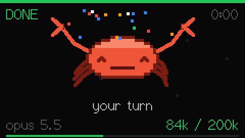<br><sub>done: confetti</sub></td><td align="center">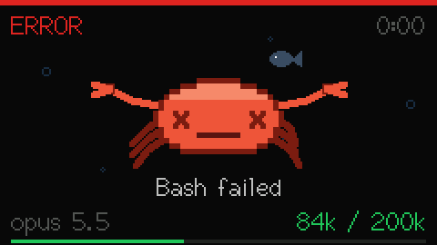<br><sub>error: slumped, X eyes</sub></td></tr>
<tr><td align="center">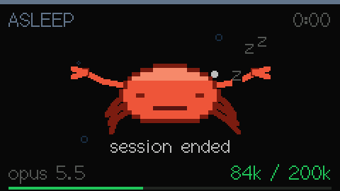<br><sub>asleep</sub></td><td align="center">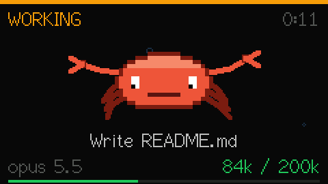<br><sub>working: typing</sub></td></tr>
<tr><td align="center">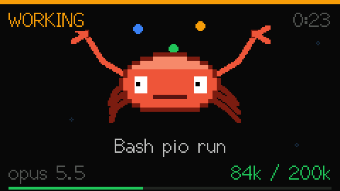<br><sub>working: juggling</sub></td><td align="center">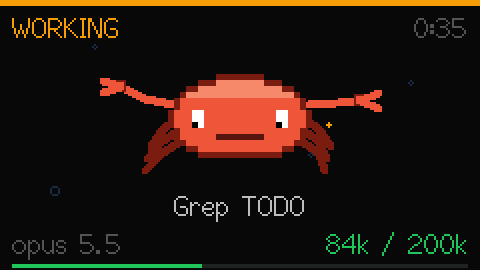<br><sub>working: hammering</sub></td></tr>
</table>

### Idle vignettes

Between jobs the crab amuses itself with one of 24 random bits of business.

<table>
<tr><td align="center"><br><sub>dance</sub></td><td align="center">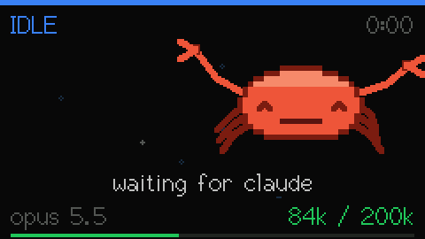<br><sub>moonwalk</sub></td></tr>
<tr><td align="center">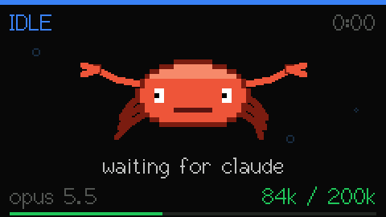<br><sub>blowing bubbles</sub></td><td align="center">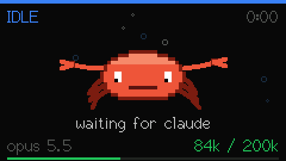<br><sub>digging</sub></td></tr>
<tr><td align="center">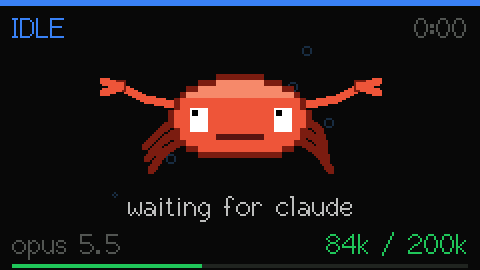<br><sub>handstand</sub></td><td align="center">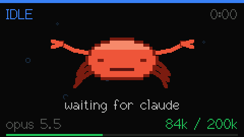<br><sub>sneeze</sub></td></tr>
<tr><td align="center">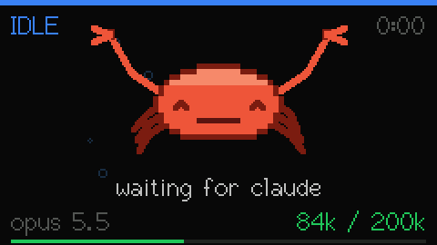<br><sub>flex</sub></td><td align="center">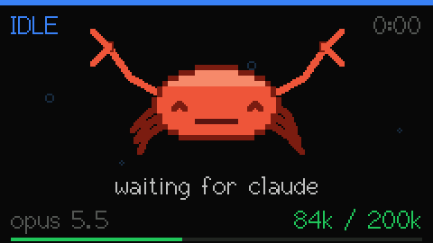<br><sub>applause</sub></td></tr>
<tr><td align="center">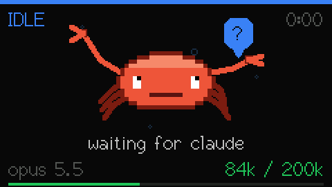<br><sub>pondering</sub></td><td align="center">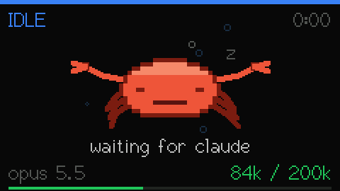<br><sub>snooze</sub></td></tr>
</table>

### Crab catch

Hold the bottom button to play. Catch pearls, dodge anchors.

<table>
<tr><td align="center">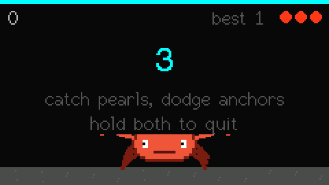<br><sub>crab catch</sub></td><td align="center">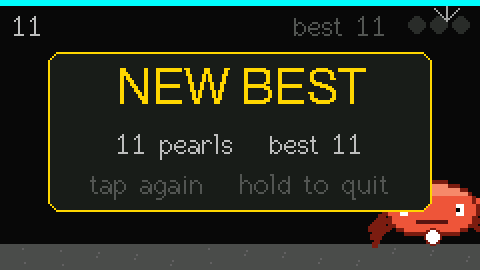<br><sub>game over</sub></td></tr>
</table>

## Hardware

| | |
|---|---|
| Board | TTGO T-Display (ESP32, 4 MB or 16 MB flash) |
| Display | ST7789 135x240, driven in landscape (240x135) |
| Bridge | CH9102 `1a86:55d4` (newer boards) or CP2104 `10c4:ea60` (older) |
| Port | auto-detected by those USB IDs; override with `CRAB_PORT` (`COM5`, `/dev/ttyACM0`, ...) |

Pins are set in `platformio.ini` as TFT_eSPI build flags, so no `User_Setup.h`
edit is needed: MOSI 19, SCLK 18, CS 5, DC 16, RST 23, backlight 4.

## States

| State | Crab | Accent |
|---|---|---|
| `idle` | bobs gently, blinks, occasional claw snip | blue |
| `working` | scuttles side to side, claws snipping, legs racing | amber |
| `approval` | both claws raised and waving, wide eyes, `!` bubble, pulsing border | red |
| `done` | claws up, eyes shut, content | green |
| `error` | slumped, looking down | dark red |
| `asleep` | eyes shut, drifting `z z z`, backlight at 4% | slate |

After five minutes with no message the puck puts itself to sleep.

## Animations

Idle picks a random vignette every few seconds and never repeats twice in a
row: mooching, blowing bubbles, dancing, digging (kicking up sand), waving,
stretching, sidestepping the full width of the screen and back, scratching its
shell, pondering with a `?`, and a brief snooze.

Working rotates every six seconds between scuttling, typing with both claws,
juggling three balls, and hammering something off-screen with sparks.

Done throws confetti. Error slumps with X eyes and sweats. Six eye modes (open,
shut, wide, X, happy, looking up) and independent left and right arms give the
poses their range.

Ambient behind all of it: bubbles drifting up, and once in a while a fish
swims past.

## Buttons

- Top (GPIO 35): tap to cycle backlight brightness, 5 steps
- Bottom (GPIO 0): tap to skip to the next idle vignette; in any other state,
  tap to step through the six states to preview them
- Bottom, held for 600 ms: start a game of crab catch

## Crab catch

Hold the bottom button and the puck stops reporting for a bit and starts
playing. Pearls and anchors fall; the crab scuttles along the seabed catching
one and dodging the other. Three lives, drawn as hearts. A pearl is a point, a
gold one is five. Every ten points the drop speeds up and anchors get likelier,
levelling off at 62% anchors and a fall every nine frames.

While playing:

| | |
|---|---|
| Top | left - hold it, the crab accelerates |
| Bottom | right |
| Both, held | quit back to status |
| Either, on the game-over card | tap to play again, hold to quit |
| Both, on the game-over card | swap left and right |

Quitting takes both buttons because mid-game a single held button is just
steering - holding left to cross the screen must not drop you back to status.

The buttons sit on one edge of the board, so which of them reads as "left"
depends on how the puck is sitting on your desk. Rather than guess, the
game-over card takes both buttons at once as "that was backwards" and flips the
mapping.

High score and the control swap live in NVS under the `crab` namespace, so they
survive reboots and reflashes.

Anything arriving on the serial port ends the game on the spot and shows the
state - a hook always wins, so you cannot miss an approval prompt because you
were busy dodging an anchor. The game also drops back to status after 60
seconds with no button press, and the five-minute sleep timer is suspended
while it runs.

## Sending states by hand

```
python hooks/crab.py working "reticulating splines"
python hooks/crab.py approval "needs your permission"
```

The board replies `ok <state>` on the same port.

## Model and token usage

The bottom row carries the model short name on the left (`opus 5`, `haiku 4.5`)
and the context size on the right (`141k / 1.0M`), over a hairline bar showing
how full the context window is. The bar and the figure turn amber past 60% and
red past 85%.

Both come from the session transcript, whose path every hook payload carries.
The context figure is the last assistant turn's `input_tokens +
cache_creation_input_tokens + cache_read_input_tokens` — what is actually
resident in the window, not a running total of everything ever sent. Only the
last 256 KB of the transcript is parsed, so the cost stays flat as a session
grows.

The window size is read from the `model` field in `~/.claude/settings.json`: a
`[1m]` suffix means 1M, anything else is assumed to be 200k. If the measured
context ever exceeds that, the larger number wins so the bar can't overflow.

## Wire protocol

Newline-terminated `state|detail|model|used|max` on USB serial at 115200.
Everything after the state is optional; omitted fields leave the previous value
alone. Detail is trimmed to 40 characters and must be ASCII. Unknown states get
an `err` reply and are ignored.

`crab.py` opens the port with DTR and RTS held low. Without that the CH9102
auto-reset circuit reboots the ESP32 on every connection, which would mean a
reset on every hook.

## Hooks

Installed by the plugin (`hooks/hooks.json`). If you'd rather not use the
plugin system, `python install_hooks.py` merges the same entries into
`~/.claude/settings.json` (backing the old file up to `settings.json.bak`), and
`--remove` takes them out. Don't use both, or every event fires twice.

Auto-detection only looks for the T-Display's own USB bridges. Generic CH340
boards are deliberately ignored, so the hooks never write to an unrelated
Arduino or 3D printer.

| Event | State |
|---|---|
| `SessionStart` | idle |
| `UserPromptSubmit` | working, showing your prompt |
| `PreToolUse` (all tools) | working, showing the tool name |
| `Notification` | approval, showing the message |
| `Stop` | done |
| `SessionEnd` | asleep |

`PostToolUse` is supported by `crab.py` but is not installed: it fires as often
as `PreToolUse` and would double the per-tool hook latency to report something
the puck already shows. Add it to `EVENTS` in `install_hooks.py` if you want
failed tools to turn the crab red.

Each hook costs roughly 150-250 ms, mostly Python interpreter startup, and runs
before the tool call it announces. If that drag is noticeable, dropping
`PreToolUse` is the biggest single saving.

A puck that is unplugged, asleep on another port, or busy is a silent no-op.
`crab.py` never raises and always exits 0 in hook mode, so it cannot wedge a
session.

## Building from source

Needs [PlatformIO](https://platformio.org/).

```
pio run                 # compile
pio run -t upload       # flash (add --upload-port COMx if several boards are plugged in)
pio device monitor      # watch the board talk back
```

To refresh the web flasher image after a change:

```
python -m esptool --chip esp32 merge-bin -o docs/firmware/crab-puck.bin   --flash-mode dio --flash-freq 40m --flash-size 4MB   0x1000 .pio/build/crabpuck/bootloader.bin 0x8000 .pio/build/crabpuck/partitions.bin   0xe000 ~/.platformio/packages/framework-arduinoespressif32/tools/partitions/boot_app0.bin   0x10000 .pio/build/crabpuck/firmware.bin
```

### Recording the gallery

The `capture` build streams every finished frame over USB at 2 Mbaud, and
`tools/capture.py` turns them into the GIFs above (needs pyserial and Pillow).
It can also drive the game with an autopilot, so no hands are needed.

```
pio run -e capture -t upload
python tools/capture.py            # or: --only done,game
pio run -e crabpuck -t upload      # back to normal; the hooks need this build
```

## Licence

MIT
